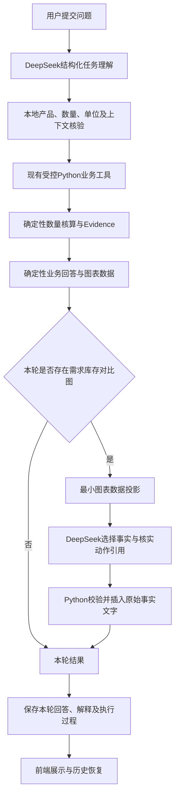

# PMC-Agent R19 图表 AI 版

版本名称：**R19 Chart AI Edition**
记录日期：2026-11-05
开发基线：R19 图表版提交 `4f54d06`
开发分支：`codex/r19-chart-ai-20261105`

本报告记录本轮代码、实际模型调用及本地验收结果。本轮不部署、不提交、不推送，也不修改业务数据。

## 1. 产品与架构

本版保持单一业务Agent结构：**DeepSeek理解任务，本地规则校验，Python工具计算，确定性组织业务回答，DeepSeek辅助组织图表解释**。



这是同一Agent的两个模型阶段，不是多Agent系统。现有LangGraph旧业务路径仍保留，但当前公开持久会话的主流程由FastAPI、Python业务适配器和现有Orchestrator协作执行，不能将所有请求描述成LangGraph图执行。

## 2. 模型与启动配置

统一客户端位于 `src/backend/config.py`：

- SDK：`langchain_openai.ChatOpenAI`。
- 模型别名：`deepseek-chat`。代码不能据此证明固定权重版本或发布日期。
- 提供商：`LLM_PROVIDER=deepseek`。
- 密钥变量：`DEEPSEEK_API_KEY`，仅后端读取。
- 地址变量：`DEEPSEEK_BASE_URL`，图表AI模式限定HTTPS的 `api.deepseek.com`，拒绝URL中的用户名、密码、查询串和片段。
- 图表AI模式默认超时25秒、重试0次，可通过既有环境变量配置。
- 模型配置就绪检查只验证配置条件；不等于一次真实模型请求已成功。

`python -m scripts.run_public` 验证公开数据包后默认设置 `PMC_CHART_AI_MODE=1`，使用现有 `api.public_app:app`。该模式在原受控评审环境中显式允许统一DeepSeek调用。`PMC_TRIAL_MODE=1`仍禁止模型出站。

配置示例只填写变量名和安全默认值，见根目录 `.env.example`。实际密钥不得进入前端、文档或Git。

## 3. 任务理解在本地业务处理之前执行

### 3.1 HTTP与理解结果复用

`src/backend/api/routes/agent.py` 的入口为：

1. `POST /api/v1/agent/resolve` 调用 `_ai_task_inputs()`取得目录与最小会话信息，再调用 `chart_ai_pipeline.understand()`。
2. DeepSeek返回结构化候选后才执行 `local_message()`和本地产品解析。
3. 返回一次性 `understanding_id`，供前端提交同一原始问题时使用。
4. `POST /api/v1/agent/query` 有有效ticket时复用本次理解；没有ticket时直接调用 `understand()`。
5. 再进入原有受控业务分流。目录、问候和非法数量也先经过理解阶段，随后按本地规则处理。

ticket绑定问题内容、有效期以及会话上下文版本；最长120秒、一次性消费。新产品会话还需符合已解析产品及初始版本约束。ticket是理解结果缓存，不是登录凭据、会话所有权或业务执行许可。

### 3.2 模型先识别，再执行本地校验

`services/chart_ai_pipeline.py` 的 `task_projection()`只执行敏感信息遮罩，并投影当前产品目录和最小会话信息。提交给模型的是用户问题原文（密钥、地址、来源文件名及校验值等敏感片段已遮罩）、目录中的产品编码/名称/别名，以及当前产品、有效需求数量和单位。它不在模型调用前用正则提取产品、数量、单位或任务意图，也不发送完整历史与Evidence。

DeepSeek先读取这些内容，按照 `TaskUnderstanding` 返回候选任务：

```json
{
  "intent": "production",
  "product_code": "TEST-PRODUCT-01",
  "material_code": null,
  "quantity": 100,
  "unit": "片",
  "needs_clarification": false
}
```

这里使用合成编码说明字段，不是固定业务答案。任务理解阶段直接提取产品、物料、数量和单位，没有P/I/Q引用协议。`quantity`可暂存整数、小数或原始数量字符串，使非法写法也能保留到本地校验；这不意味着业务服务接受小数或非法数量。缺数量的新生产请求返回null，模型不能补默认数量。

Schema拒绝额外字段和非有限数值，产品/物料候选还需通过目录或用户原文一致性检查。模型不能把生成的产品或物料直接加入业务数据，也不能返回SQL或执行指令。

随后，`local_message()`与原有 `production_request_context.parse_quantity()`执行本地语法、单位和上下文核验。显式生产请求保留原文，包括合法、非法、歧义和缺失数量；模型候选不能把“生产10片”改成最大产量查询，也不能把缺数量的新生产任务改成其他任务。产品别名和模糊解析仍由 `agents/product_resolver.py`核验，模糊结果不得直接成为业务事实。

用户的新合法参数覆盖旧需求；非法或不完整请求不能借用旧数量伪装成本轮计算，产品切换也不能借用旧产品需求。

本阶段的任务候选Schema与第6节的图表解释Schema不同：任务理解提取实际候选参数；图表解释仍采用只读事实和动作ID引用，由Python插入已核验数字。

## 4. 现有工具与业务计算复用

### 4.1 Published Tool Registry

`agents/tool_registry.py`保留白名单、参数要求和范围绑定：

| 注册名 | 职责 |
|---|---|
| `inventory_query` | 已发布库存事实查询 |
| `batch_inventory_query` | 批次库存查询 |
| `bom_query` | 已发布BOM关系查询 |
| `production_analysis` | 原有生产能力分析 |
| `purchase_plan` | 原有采购规划 |
| `inventory_risk_analysis` / `inventory_risk` | 库存风险分析 |
| `inventory_fifo` | FIFO分析 |
| `published_product_search` | 已发布产品发现 |

白名单存在不代表每个产品都具有对应数据。产品服务继续使用其原有可访问工具和数据范围。

### 4.2 账面数量核对路径

`PersistentAgentService.query()`在原有上下文校验后使用已有能力适配器、Book查询或Orchestrator。当前产品不会为增加AI而替换既有计算路径。

`tools/book_inventory_tools.py`提供：

- `enterprise_book_inventory_query` → `BookInventoryService.inventory()`。
- `enterprise_book_demand_analysis` → `BookInventoryService.analyze()`或当前产品既有派生服务。
- `enterprise_book_capacity_query` → `BookCapacityQueryService.query()`。

KQ-Z112当前配置仍通过 `CurrentBusinessRepository`及 `CurrentBusinessService`绑定；其他产品保留现有Repository与工具。BOM单耗、数量展开、库存匹配、差额、最大数量和重复记录口径均沿用Python服务。本轮没有重新筛选物料、修改库存或重写MRP算法。

原有Planner/ResponseGenerator仍可用于既有兼容路径。本版新增理解入口位于业务分流之前，最终业务数字仍由确定性结果组织，不依赖模型自由生成。

## 5. 数据访问与会话

### 5.1 运行数据

公开启动唯一业务包为 `data/public/`，由 `release.json`声明文件及校验值。`repositories/public_data_repository.release_settings()`检查格式、路径边界与SHA-256；`PublicInventoryRepository.load()`读取 `pmc_excel_observations_v1` JSON，不让Agent直接读取Excel。

现有 `BookInventoryRepository.load()`体现Excel映射规则：读取指定主工作表，将料号、库存、库位、批次和单位解析为结构化观察记录，使用Decimal并保留行级来源；缺失、错误及重复记录单独标记。发布运行使用已准备的JSON及BOM数据库，本轮不重新导入或重新发布数据。

`CurrentBusinessRepository`校验BOM、库存、别名之间的一致性和来源确认绑定。BOM关系来自当前发布包或只读Published Facts。不得把业务包完整性校验等同于现场库存时效性证明。

### 5.2 持久会话

`AgentConversationRepository`保存：原始用户问题、业务响应、上下文版本和事实引用。当前有效生产需求按产品、版本和本轮状态继承；产品切换沿用原有新会话机制。

`append_turn()`前的完成钩子调用 `finish_response()`，在原有事务保存前将图表AI解释及真实执行事件写入本轮响应。刷新和历史恢复读取当时保存的响应，不用新解释覆盖旧回答。模型请求不放在SQLite写锁事务内部。

本轮没有新增多人登录或角色系统；理解ticket不替代会话访问控制。真实库存写入仍保持原有权限边界，本轮不开放新的执行权限。

## 6. 图表AI解读契约

### 6.1 生成条件与出站字段

`services/chart_ai_service.chart_projection()`仅为本轮有效生产数量且具有需求/库存图表的 `production`或 `shortage`结果构造投影。普通BOM、库存、目录、来源、最大数量和非法输入不附加无关图表解读。

投影包括产品编码、名称、目标数量和单位，以及物料编码、名称、需求、已核验库存、缺口、匹配状态和覆盖信息。库存优先使用后端已归一化数量；无记录、未确认重复和不可比较单位保持未匹配，不填0。投影不包含来源文件、路径、SHA、完整Evidence、历史对话或凭据。

### 6.2 模型选择引用，Python填入事实

`ChartReply`严格限定：

```json
{
  "verdict": "insufficient",
  "finding_ids": ["coverage", "m0"],
  "impact_id": "target_shortage",
  "action_ids": ["stock_m0"]
}
```

Python按工具结果生成只读事实库和核实动作库。DeepSeek选择相关引用；Python验证结论与范围一致、必需事实完整、引用有效且不重复后，再从本地事实库插入原始数字与文字。模型不能自由改写数量、物料、库存或生产满足状态。

成功返回：

```json
{
  "chart_ai": {
    "status": "ok",
    "source": "llm",
    "egress_policy": "approved_chart_projection_v1",
    "sections": {
      "conclusion": "本轮核心结论",
      "findings": ["本轮关键物料事实"],
      "impact": "目标数量与核算范围",
      "actions": ["具体核实动作"]
    }
  }
}
```

以上是字段示例，不是固定业务答案。`source=llm`只在实际模型调用且校验成功后设置，不能由本地模板冒充。

### 6.3 失败处理

- 理解API超时、失败或结构错误：返回 `status=model_unavailable`，本轮不执行业务工具，不静默回退成完整DeepSeek成功。
- 图表模型失败或事实引用矛盾：`chart_ai.status=unavailable`，保留已完成的Python业务回答、数字、明细和来源。
- 本轮没有适用图表：`chart_ai.status=not_applicable`。
- 不向浏览器返回提供商原始异常、请求正文或密钥。

两阶段严格区分：第一阶段失败不能伪装成理解成功；第二阶段失败不能抹掉已经算出的业务结果。

## 7. 前端展示与长期文案规则

新增 `ChartAiInterpretation.vue`位于需求/库存图表完整区域之后、缺料图之前，处于图表横向滚动容器之外。四块内容为核心结论、关键物料发现、生产计划影响、后续核实建议。

新增 `AgentExecutionTrace.vue`提供可展开的执行过程。`services/chartAi.ts`及 `responseAdapter.ts`只适配后端字段，不生成假解读或假Tool事件；旧响应没有新增字段时仍正常展示。

实际执行事件由 `chart_ai_pipeline.execution()`的请求级ContextVar采集：模型理解、本地核验、真实Tool调用、目录投影、计算或复用、回答与图表解释。不展示内部思维链，不从静态完成步骤伪造工具调用。问候和非法数量的计算阶段标记为本轮无需。

用户可见文字统一：先给结论与关键数字，再提供展开明细和来源。缺失数据用“库存数据未匹配，暂不参与核算”等业务状态表达。正常结果不输出系统自我辩护、冗长免责声明或无依据承诺；数据读取失败和部分覆盖仍如实呈现。

## 8. 决策建议边界

库存缺口排序只是数量差额排序，不等同于采购优先级。单耗、库存和缺口不提供供应商交期、在途订单、替代料或采购承诺。

本版解读仅从已有事实生成具体动作，例如核实对应物料库存与未交付订单、结合供应商交期评估补料。缺少这些字段时不生成价格、到货日期、立即采购或采购排序。不同物理单位的缺口不直接比较大小。

部分覆盖的正确表述是“已核算物料满足本次数量，另有库存待匹配”；只有全部必需物料完成比较才能表达全部满足。已核实缺料与未知库存分开。

## 9. 主要修改与测试文件

| 文件 | 本轮职责 |
|---|---|
| `src/backend/services/chart_ai_pipeline.py` | 理解入口、最小上下文、一次ticket、本地路由保护、执行事件和完成钩子 |
| `src/backend/services/chart_ai_service.py` | 图表投影、DeepSeek引用选择、校验与四块解读 |
| `src/backend/config.py`、`.env.example` | 统一DeepSeek配置与模式边界 |
| `scripts/run_public.py` | 图表AI标准启动模式 |
| `src/backend/api/routes/agent.py`、`api/schemas/agent.py` | `/resolve`与`/query`接入及可选ticket字段 |
| `src/backend/repositories/agent_conversation_repository.py` | 原有会话写入前保存本轮解释与执行事件 |
| `src/backend/tools/book_inventory_tools.py`、`agents/orchestrator.py`、`agents/reviewer_catalog_queries.py` | 实际工具事件与目录处理 |
| `frontend/src/components/ChartAiInterpretation.vue`、`AgentExecutionTrace.vue` | 四块解读及可展开执行过程 |
| `frontend/src/services/chartAi.ts`、`backendTypes.ts`、`responseAdapter.ts`、`apiClient.ts` | 可选响应适配与ticket传递 |
| `frontend/src/components/ResultPanel.vue`、`composables/agentStore.ts` | 图表位置、请求与当前消息绑定 |
| `tests/test_chart_ai_service.py` | 合成图表、超时、格式、矛盾、覆盖、单位及出站白名单回归 |
| `tests/test_chart_ai_pipeline.py` | 真实HTTP入口配合注入模型，验证顺序、数量、上下文、ticket和失败状态 |
| `tests/test_business_presentation_ai.py`、`frontend/tests/chart_ai.test.mjs` | 业务文案与前端解读/执行过程契约 |

其他本轮业务文案调整以最终Git差异清单为准，不能据此推断核心业务计算发生变化。

## 10. 验收记录

| 项目 | 本轮状态 |
|---|---|
| 基线Python | 主验收已重新确认363项通过 |
| 基线前端 | 主验收已重新确认97项通过 |
| 新增图表服务测试 | 37项通过，使用合成数据和注入模型，无外部请求 |
| 新增Pipeline测试 | 48项通过；合成事实、隔离会话及注入模型 |
| 最终Python全量 | 457 passed，0 failed，0 skipped，3项第三方弃用警告 |
| 最终前端全量 | 126 passed，0 failed，0 skipped；原97项保留，新增29项 |
| Typecheck与Production Build | 均通过；487模块；最终资源为index-DlwgpVgN.js / index-udayGt4x.css |
| DeepSeek真实在线理解 | 最终21条HTTP问题均实际调用deepseek-chat并通过结构化校验 |
| 真实HTTP及连续对话 | 21/21符合预期，含0/分数拒绝；需求、缺口和最大数量独立Decimal复算一致，历史恢复一致 |
| 图表DeepSeek真实解读 | 最终10个适用结果均source=llm；其余问题不生成无关图表 |
| 浏览器主题、宽度、滚动及恢复 | 正式构建累计12次实际提交；目录/生产/BHX历史3次恢复；深浅主题、390px窄屏、图表横向滚动和切换均核验 |
| 业务数据完整性及Git差异检查 | data/public的17个文件SHA-256全部不变；git diff --check通过；没有暂存、提交、推送或部署 |

合成Mock测试可以证明接口契约、边界和异常处理，不能代替真实DeepSeek在线成功。最终验收必须分别报告理解阶段和图表解释阶段的调用结果、失败次数及实际来源。

### 现场案例记录模板

| 案例 | 输入路径 | 必须核对 | 本轮实际记录 |
|---|---|---|---|
| 满足数量 | 查询Z112 BOM→生产54片 | 34项物料均满足；当前最大满足54片 | 真实DeepSeek理解、Tool、表格和图表一致 |
| 缺料 | 生产55片→为什么不能生产 | MAT-004单耗24、需求1320、库存1308、缺口12 | 真实解读与Python一致 |
| 图表解读 | 对55片结果自动解读 | 四块解读、最大缺口、具体核实动作 | source=llm，引用与结论校验通过 |
| 连续追问 | 100片采购→50片→采购建议 | 改用50片，已核实库存满足，无需补料清单 | 来源仍对应本轮，历史一致 |
| 失败恢复 | 生产0片→生产1片 | 0片无Tool；后续1片使用34项正确核算 | HTTP与浏览器均通过 |

实际输入、输出摘要与核验依据见[r19_chart_ai_acceptance.json](r19_chart_ai_acceptance.json)。完整原始验收日志保存在项目外验收目录，未将来源路径或完整Evidence复制到此文档。

运行截图：

- [Agent执行过程](assets/r19-chart-ai/execution-trace.png)
- [图表AI解读（完整工作台）](assets/r19-chart-ai/workbench-dark.png)
- [深色完整工作台](assets/r19-chart-ai/workbench-dark.png)
- [浅色工作台](assets/r19-chart-ai/workbench-light.png)
- [窄屏工作台](assets/r19-chart-ai/workbench-mobile.png)
- [BHX部分覆盖与历史恢复](assets/r19-chart-ai/bhx-partial-restored.png)
- [采购服务与核实建议](assets/r19-chart-ai/purchase-service.png)

### 本轮问题记录

- 初次新测试有2项夹具未绑定BOM/目录而失败，补齐合成夹具后通过，没有修改旧断言。
- 完整回归曾有5项采购文字状态断言失败，恢复“未生成确定采购数量”等客观业务状态后通过，未恢复免责声明。
- 任务理解最初采用匿名参数引用，在线追问曾拒绝一次无效引用；最终改为模型直接提取候选参数，再本地校验，保留严格校验。
- 构建曾因重复checked状态键失败，删除重复键后Typecheck/Build通过。
- 在线复验出现过1次真实OpenAITimeoutError（约25秒），/resolve返回503，未执行业务计算。最终21条验收首试全部通过，验收重试次数为0。
- 验收脚本改为每轮独立保存；没有把超时、尚在等待的页面或未提交的输入记为成功。

最终测试命令（临时目录放在项目外）：

```powershell
$env:PMC_CHART_AI_MODE='0'
$env:PMC_REVIEW_MODE='1'
.\.venv\Scripts\python.exe -B -m pytest tests -p no:cacheprovider --basetemp <external-test-dir> -q --tb=short
cd frontend
npm test
npm run typecheck
npm run build
```

全量测试的兼容模式防止旧测试意外联网；新增48项Pipeline夹具显式启用AI模式并注入合成模型。真实HTTP另用标准AI模式和实际DeepSeek完成。两者没有混同。

实际代理服务事件分为注册Tool和兼容Python服务：Book/Orchestrator在真实invoke边界记录tool，PmcCapabilityQueries.run只有处理本轮并返回结果后记录service。目录投影单独标catalog，不伪造published_product_search工具调用。

## 11. 回滚与未完成边界

显式兼容模式可设置 `PMC_CHART_AI_MODE=0`并仅重启本项目服务，恢复原有确定性问答入口；这不是本版AI验收状态。现有会话保留，新增响应字段是可选字段。

代码回滚前保存本轮差异与未跟踪文件清单，再对比基线逐文件恢复本轮修改，或在另一个目录检出基线进行运行。不得用整目录覆盖、数据库恢复、重新发布、`reset --hard`或清理命令撤销功能。

本轮不回滚或修改BOM、库存、源Excel、发布数据包、历史会话和Git历史。已知旧版业务问题需单独跟踪，不能通过改数据、降测试或宣称AI成功掩盖。

本地R19图表AI功能与真实DeepSeek验收已完成。以下不属于本轮已完成项：

- 未部署腾讯云、未开启公网、未执行Ubuntu/Docker实机部署。
- 原有会话所有权/多人权限问题未在本轮解决，理解ticket不是用户身份凭据。
- 之前审查中的通用混合单位最大产量问题未改；当前两个产品统一片的54/38结果已独立复算，不能据此宣布通用换算问题已修复。
- 多worker下ticket需同实例或共享存储；当前标准启动workers=1，未进行多worker负载验收。
- 本机浏览器曾观察到系统防护软件注入脚本标签，项目源码与构建不含该域名；验收中资源加载大小为0、对应全局对象未定义，未改系统防护设置。

没有开放企业库存写入，没有修改业务数据或MRP/BOM算法，没有Git提交、推送或线上操作。


## 12. 最终文件清单

已跟踪修改：

- `.env.example`
- `README.md`
- `docker-compose.yml`
- `docs/reviewer_remote_guide.md`
- `frontend/package.json`
- `frontend/src/components/AnalysisState.vue`
- `frontend/src/components/AppShell.vue`
- `frontend/src/components/BackendDetails.vue`
- `frontend/src/components/InventoryGapChart.vue`
- `frontend/src/components/InventoryTrendChart.vue`
- `frontend/src/components/LiveSessionControls.vue`
- `frontend/src/components/MaterialTable.vue`
- `frontend/src/components/MessageList.vue`
- `frontend/src/components/QueryComposer.vue`
- `frontend/src/components/RecommendationPanel.vue`
- `frontend/src/components/ResultPanel.vue`
- `frontend/src/components/ShortageBarChart.vue`
- `frontend/src/components/SourceDetails.vue`
- `frontend/src/components/WarningList.vue`
- `frontend/src/composables/agentStore.ts`
- `frontend/src/data/model.ts`
- `frontend/src/services/apiClient.ts`
- `frontend/src/services/backendTypes.ts`
- `frontend/src/services/responseAdapter.ts`
- `scripts/run_public.py`
- `src/backend/agents/business_answer.py`
- `src/backend/agents/business_formatter.py`
- `src/backend/agents/enterprise_book_queries.py`
- `src/backend/agents/orchestrator.py`
- `src/backend/agents/planner.py`
- `src/backend/agents/query_presentation.py`
- `src/backend/agents/response_generator.py`
- `src/backend/agents/reviewer_catalog_queries.py`
- `src/backend/agents/slim_review_queries.py`
- `src/backend/api/routes/agent.py`
- `src/backend/api/schemas/agent.py`
- `src/backend/config.py`
- `src/backend/repositories/agent_conversation_repository.py`
- `src/backend/services/current_business_service.py`
- `src/backend/services/local_business_binding.py`
- `src/backend/services/persistent_agent_service.py`
- `src/backend/services/pmc_capability_service.py`
- `src/backend/services/slim_review_presentation.py`
- `src/backend/tools/book_inventory_tools.py`

本轮新增：

- `docs/R19_CHART_AI_EDITION.md`
- `docs/assets/r19-chart-ai/bhx-partial-restored.png`
- `docs/assets/r19-chart-ai/execution-trace.png`
- `docs/assets/r19-chart-ai/purchase-service.png`
- `docs/assets/r19-chart-ai/workbench-dark.png`
- `docs/assets/r19-chart-ai/workbench-light.png`
- `docs/assets/r19-chart-ai/workbench-mobile.png`
- `docs/r19_chart_ai_acceptance.json`
- `frontend/src/components/AgentExecutionTrace.vue`
- `frontend/src/components/ChartAiInterpretation.vue`
- `frontend/src/services/chartAi.ts`
- `frontend/tests/chart_ai.test.mjs`
- `src/backend/services/chart_ai_pipeline.py`
- `src/backend/services/chart_ai_service.py`
- `tests/test_business_presentation_ai.py`
- `tests/test_chart_ai_pipeline.py`
- `tests/test_chart_ai_service.py`
